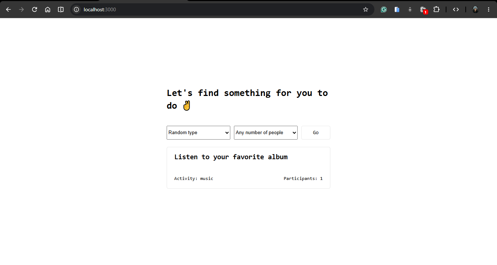

# 🎯 Boredom Breaker

Ever find yourself bored and wondering what to do? **Boredom Breaker** is a web application that suggests activities to help you find something interesting to do.

Built as part of my backend development learning journey with Angela Yu's Web Development course, this project gave me hands-on practice consuming a real-world API using Axios, including making GET and POST requests.

---

# 📸 Screenshot


---

# Link
[Click Me](https://boredom-breaker.onrender.com)
 
---

## ✨ Features

- Get activity suggestions to help beat boredom.
- Retrieve data from an external API using Axios.
- Send POST requests to interact with an API.
- Render dynamic content using EJS templates.
- Handle HTTP requests with Express.js.

---

## 🛠️ Tech Stack

- **Node.js:** JavaScript runtime for the server.
- **Express.js:** Web application framework.
- **EJS:** Dynamic HTML templating.
- **Axios:** Making HTTP requests to an external API.
- **CSS:** Styling and layout.
- **Bored API:** Providing activity suggestions.

---

## 🌐 API Reference

This project uses the [Bored API by App Brewery](https://bored-api.appbrewery.com/) to retrieve activity suggestions.

The API provides endpoints for retrieving random activities and filtering activities by criteria such as type and number of participants.

For full endpoint details, see the [official API documentation](https://bored-api.appbrewery.com/).

---

## 🚀 Getting Started

Follow these steps to run the project locally.

### Prerequisites

- [Node.js](https://nodejs.org/)
- npm
- Git

### Installation

1. Clone the repository:

   ```bash
   git clone 
   ```

2. Navigate into the project directory:

   ```bash
   cd boredom-breaker
   ```

3. Install the dependencies:

   ```bash
   npm install
   ```

4. Start the application using the appropriate script defined in `package.json`.

   For example, if your project uses a `start` script:

   ```bash
   npm start
   ```

5. Open your browser at the local URL displayed in your terminal, typically `http://localhost:3000`.

---

## 📚 What I Learned

Through this project, I practised:

- Making HTTP requests with Axios.
- Understanding GET and POST request methods.
- Working with external APIs and JSON responses.
- Using Express.js to handle routes and requests.
- Passing data from the server to EJS templates.
- Rendering dynamic content in a web application.

---

## 🎓 Acknowledgements

This project was built as part of my web development learning journey through [Angela Yu's Web Development course](https://www.udemy.com/course/the-complete-web-development-bootcamp/).

Thanks to App Brewery for providing the Bored API used in this project.

---

## 👨‍💻 Author

**Isaiah Ayomide Yenou**

- GitHub: [Isaiah Ayomide Yenou](https://github.com/yenisaa)

---

*Built for learning, one project at a time.*